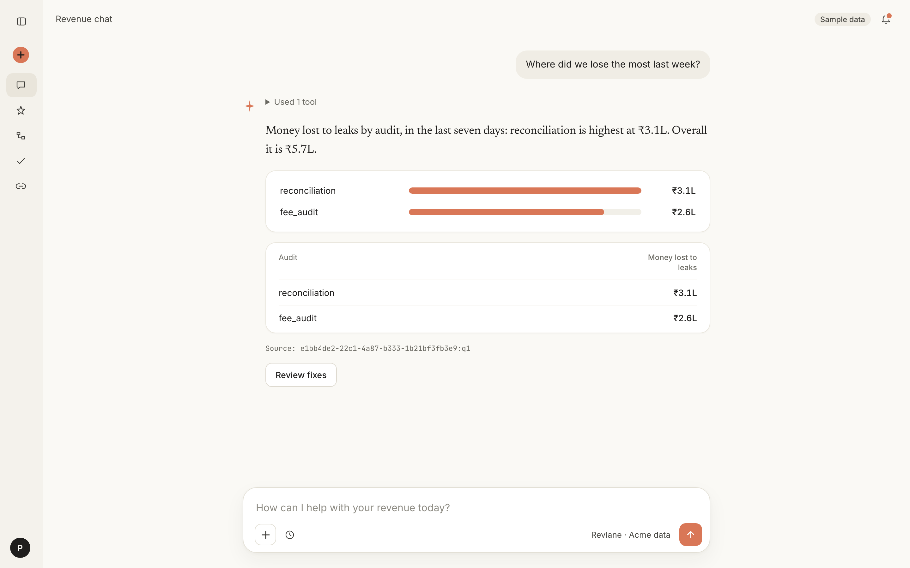
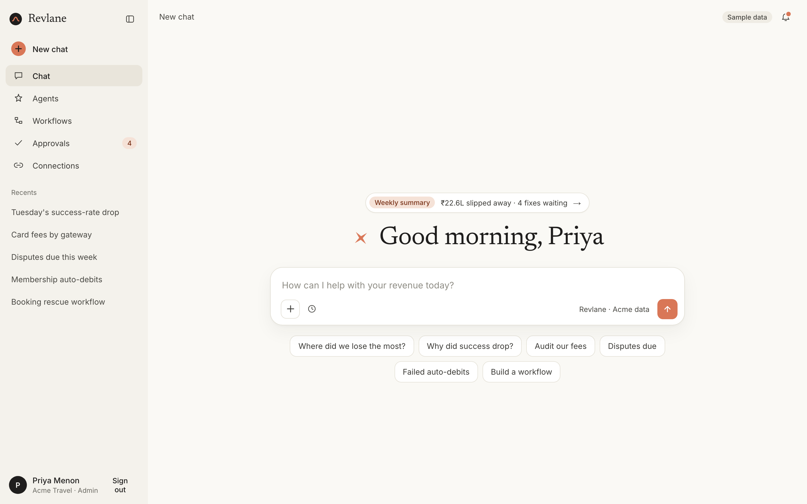
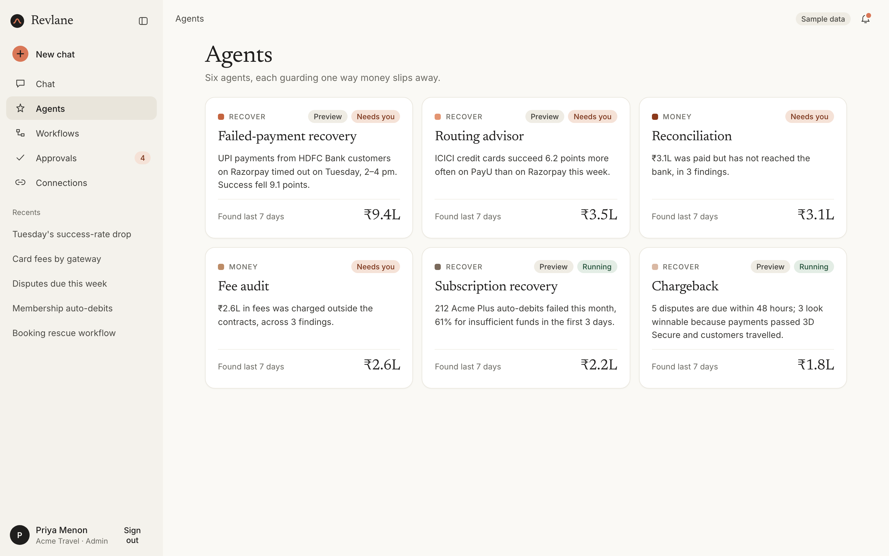
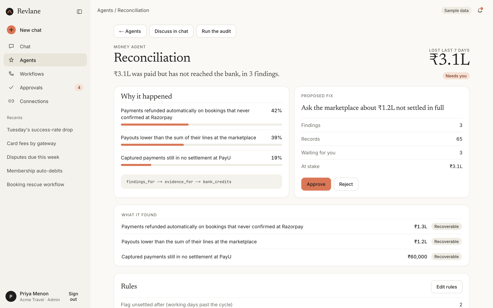
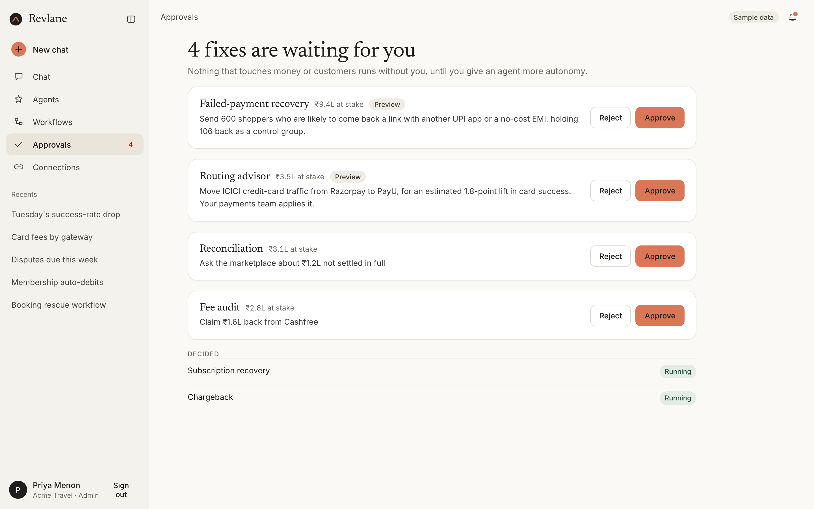
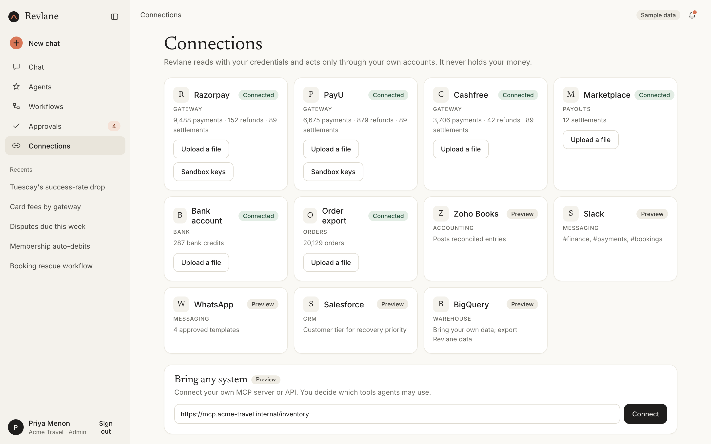
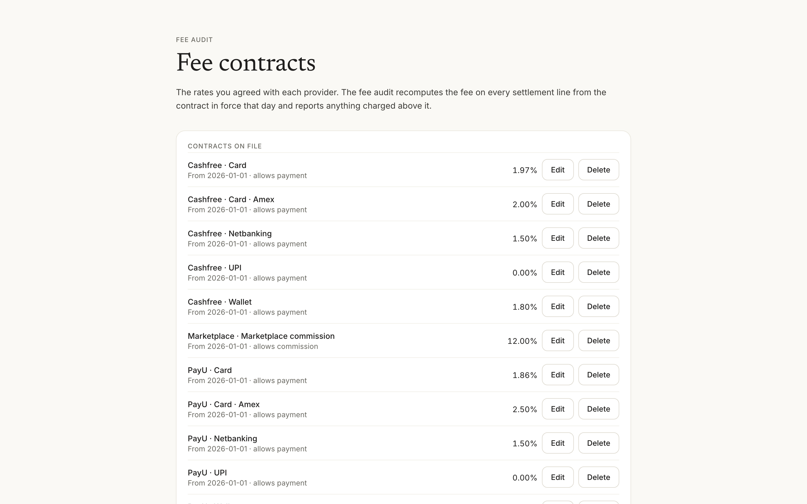

# Revlane: Payment AI

**Revlane shows an online merchant what happened to every rupee between checkout and the bank account, across every payment provider, and helps get back the money it is owed.**



## What we are trying to do

A mid-market Indian merchant takes payments through two or three gateways (Razorpay, PayU, Cashfree), a marketplace and cash on delivery. Money leaks out quietly along the way:

- a gateway settles less than it collected;
- fees are charged above the rate in the contract;
- a payment is captured, then refunded automatically, and never reaches the bank.

No one sees the total, because each provider shows only its own slice and no single team owns the whole picture.

Revlane connects the merchant's gateways, bank statements and order data and maps them onto one payments model. It then matches every order to its payment, its settlement and the bank credit, and checks every fee against the contract. Whatever does not add up becomes a **finding** with its evidence attached.

AI agents explain each finding in plain English and draft the claim to the provider. **A person approves everything, and nothing is sent on the merchant's behalf.** Revlane keeps three numbers separate and never mixes them: money **lost**, money still **recoverable**, and money **recovered** (it has reached the bank).

The first version sets out to prove one thing: that Revlane finds money a multi-gateway merchant did not know it was owed, shows the evidence, and drafts the claim.

## A look around

All screens below run on the synthetic merchant, *Acme Travel*: a fictional company with leaks planted in its data and an answer key the engines are tested against.

### Ask Revlane

Ask about your own payments in plain English. The model turns the question into a structured query; code compiles that into SQL and inserts every figure, and each answer cites its source.



### Agents

Six agents, each guarding one way money slips away. Reconciliation and Fee audit run on the real engines; the others are previews on sample data.



### A finding, explained

The Reconciliation agent shows why money is missing, what it found and the fix it proposes. Nothing happens until someone approves it.



### Approvals

Every proposed fix waits here for a person to approve or reject it.



### Connections and fee contracts

Gateways, marketplace payouts, bank statements and order exports come in through sandbox keys or file uploads. The fee audit recomputes every settlement line from the contract in force that day.





## What is real and what is a preview

- **Real engines:** reconciliation, fee audit, Ask Revlane, approvals, and the gateway, bank and order connections.
- **Preview (sample data, marked "Preview" in the console):** failed-payment recovery, routing advisor, chargeback, subscription recovery, workflows, routines, skills and custom MCP servers.

## Rules the product never breaks

- Money is stored in whole paise, never as floating-point numbers.
- The model never produces a number and never writes SQL; code does both.
- Every tenant's data is isolated with row-level security in Postgres.
- Every proposed action needs a person's approval, and nothing is sent to a provider or customer.
- Card numbers and shopper contact details are dropped at ingestion.
- Only sandbox and synthetic data; no production provider calls.

## Run it locally

You need Python 3.12 with [uv](https://docs.astral.sh/uv/), Node 24, and Docker or a Postgres 16 server on `localhost:5432`.

```bash
cp .env.example .env
make install
make demo
```

Open http://localhost:3000 and sign in as `priya.menon@acmetravel.example` with the password in `DEMO_USER_PASSWORD` in your `.env`. No model API key is needed: the agents and chat run on a deterministic stub. See [docs/RUNBOOK.md](docs/RUNBOOK.md) for everything else.

## Stack

| Part | Built with |
| --- | --- |
| `apps/api` | Python 3.12, FastAPI, SQLAlchemy 2, Alembic, pytest |
| `apps/web` | TypeScript, Next.js (App Router), Tailwind CSS, Vitest, Playwright |
| Data | Postgres 16: operational data, analytics and the job queue |
| AI | One model provider behind `apps/api/revlane/llm/client.py`, with a deterministic stub for tests |

## Documents

| File | Purpose |
| --- | --- |
| [`docs/product-brief.md`](docs/product-brief.md) | Why Revlane exists and what the first version must prove |
| [`docs/technical-design.md`](docs/technical-design.md) | Architecture, data model, connectors, matching and fee logic, agents, chat, safety, security |
| [`docs/design-spec.md`](docs/design-spec.md) | Screens, components, design tokens and copy |
| [`docs/synthetic-merchant.md`](docs/synthetic-merchant.md) | The fictional merchant, the planted leaks and the answer key |
| [`docs/build-plan.md`](docs/build-plan.md) | Nine milestones, each with scope and acceptance tests |
| [`docs/RUNBOOK.md`](docs/RUNBOOK.md) | How to run, seed, test and extend Revlane |
| [`docs/security-checklist.md`](docs/security-checklist.md) | Each rule above and the test that enforces it |
| [`docs/deployment.md`](docs/deployment.md) | Deployment guide |
| [`design/prototype.dc.html`](design/prototype.dc.html) | The prototype's markup, styles and copy |

## How it was built

Revlane was built with Claude Code, milestone by milestone, from the prototype and the documents above. [`CLAUDE.md`](CLAUDE.md) holds the standing instructions and [`KICKOFF_PROMPT.md`](KICKOFF_PROMPT.md) is the first message that started the build.
